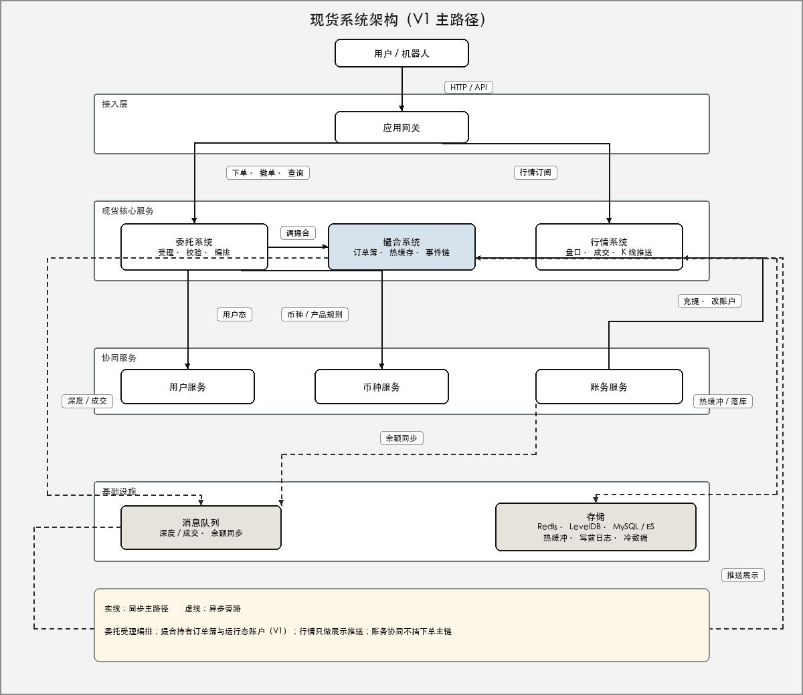

<div class="doc-eyebrow">现货手册 / TGEX KNOWLEDGE BASE</div>

# 系统架构

<div class="doc-lead">本页回答三件事：系统分成哪几层、各组件管什么、交易当下的权威态落在哪里。业务结果见[业务概述](/pages/0701)；规则与对象见[交易规则](/pages/0703)、[核心设计](/pages/0704)。</div>

<p align="center" class="spot-flow-figure">
  
</p>

| 图例 | 含义 |
| --- | --- |
| 实线 | 同步主路径：下单 / 撤单 / 查询要等这条链路给出结果 |
| 虚线 | 异步旁路：深度、成交推送、落库、余额协同；不挡受理回包 |

范围说明：本文描述**平时正常交易**下的 V1 主路径（平台撮合）。启动恢复见[撮合初始化链路](/pages/070505)；缓存键值见[缓存总览](/pages/070801)。市价单与第三方撮合不在本图主路径。

## 设计取舍 {#principles}

读图时先记住四条边界，后面分层都绕着它们转：

1. **受理与撮合分离**：委托负责校验与编排；撮合持有订单簿与运行态账户，真正改「可用 / 冻结」和「单还剩多少」。  
2. **交易热路径权威在撮合进程内**：Redis / MySQL / ES 是缓冲与落库，不替代撮合内存里的权威态。  
3. **行情只做展示推送**：盘口、成交、K 线来自撮合事件的异步消费，不裁定订单或账本对错。  
4. **账务协同不挡下单主链**：充提、改账经账务进入；下单当场的冻结发生在撮合侧，账务不夹在「点下单 → 回成功」的实线中间。

因此不要按教科书式「撮合只比价、账务只记账」去理解现状——V1 里二者是协同关系，热路径账户态在撮合。

## 分层与职责 {#layers}

| 层 | 组件 | 职责 |
| --- | --- | --- |
| 接入层 | 应用网关 | 统一入口：App / 网页 / 开放 API / 机器人；转发下单、撤单、查询与行情订阅 |
| 现货核心 | 委托 · 撮合 · 行情 | 交易闭环：受理编排、撮合与热状态、展示推送 |
| 协同服务 | 用户 · 币种 · 账务 | 可交易态、产品规则、充提与账户协同 |
| 基础设施 | 消息队列 · 存储 | 异步解耦；热缓冲、写前日志与冷数据 |

### 现货核心

| 组件 | 职责 | 边界 |
| --- | --- | --- |
| 委托系统 | 入参与业务规则校验；幂等；编排调撮合；对外返回委托编号 | **受理成功 ≠ 全部成交**；不持订单簿，不改运行态余额 |
| 撮合系统 | 订单簿、按交易对串行的事件链；账户热缓存上的冻结 / 成交 / 解冻 | 交易当下可用与冻结的权威在此；对外产出深度与成交事件 |
| 行情系统 | 消费深度 / 成交，推盘口、成交记录、K 线 | 只读展示路径；不改委托状态与账本 |

### 协同服务

| 组件 | 在主路径上的位置 |
| --- | --- |
| 用户服务 | 委托校验阶段查询：用户能否交易 |
| 币种服务 | 委托校验阶段查询：交易对开关、精度、价量规则等 |
| 账务服务 | 充提、改账户；经消息与撮合做余额协同；**不在**下单同步主链上卡点 |

模块级清单见[功能全景](/pages/0102)。

## 主路径与旁路 {#paths}

**同步主路径（实线）**

```
用户 / 机器人 → 网关 → 委托（校验用户 / 币种规则）→ 撮合（预检 → 冻结建单 → 进簿处理）→ 回包
```

回包含义：委托已受理、资金已按规则占用。是否立即全部成交，取决于撮合后续是否对上对手盘，见[下单主流程](/pages/070502)、[撮合主流程](/pages/070508)。

同类同步入口还有：

| 入口 | 文档 |
| --- | --- |
| 撤单 | [撤单主流程](/pages/070503) |
| 委托查询 | [委托查询主流程](/pages/070510) |
| 行情订阅 | 网关 → 行情；**数据内容**仍靠下方虚线推过来 |

**异步旁路（虚线）**

| 旁路 | 路径 | 文档 |
| --- | --- | --- |
| 深度 / 成交 | 撮合 → 消息队列 → 行情 → 客户端 | [行情推送流程](/pages/070509) |
| 热缓冲 / 落库 | 撮合 → 存储 | [撮合主流程](/pages/070508) 文末 |
| 余额同步 | 账务 ↔ 消息队列 ↔ 撮合 | [充提改账协同](/pages/070511) |
| 手续费计费 | 成交时在撮合内存扣费并暂存 | [手续费计费落地](/pages/070512) |

## 职责对照速查 {#ownership}

| 问题 | 答案 |
| --- | --- |
| 谁给可追踪的委托编号？ | 委托系统（编排撮合受理成功后） |
| 谁决定能否挂上簿、成不成交？ | 撮合系统 |
| 交易当下可用 / 冻结以谁为准？ | 撮合进程内账户热缓存 |
| 谁改充提导致的余额？ | 账务发起，与撮合协同落热缓存 |
| 谁把盘口推到屏幕？ | 行情系统（异步） |

## 工程对照 {#modules}

| 图上名称 | 工程 | 关注点 |
| --- | --- | --- |
| 应用网关 | coinex-app | 接入与转发 |
| 委托系统 | coinex-entrust | 校验、编排、查询 |
| 撮合系统 | coinex-match | 订单簿、热缓存、事件链 |
| 行情系统 | coinex-market | 盘口 / 成交 / K 线推送 |
| 用户服务 | coinex-user | 可交易态 |
| 币种服务 | coinex-coin | 币种与交易对规则 |
| 账务服务 | coinex-account | 充提、改账、余额协同 |

## 读后续文档时用得上的事实 {#facts}

- 撮合按交易对串行处理下单、撤单、改账等事件，避免同簿 / 同钱包并发写乱序。  
- 委托常见类型：限价、市价；本册流程以限价为主路径。  
- 存储分层（热缓冲、写前日志、冷库）服务恢复与查询，详见[数据存储与缓存](/pages/0303)；本页不展开运维步骤。

同组：[业务概述](/pages/0701) · [交易规则](/pages/0703) · [核心设计](/pages/0704) · [缓存总览](/pages/070801)
