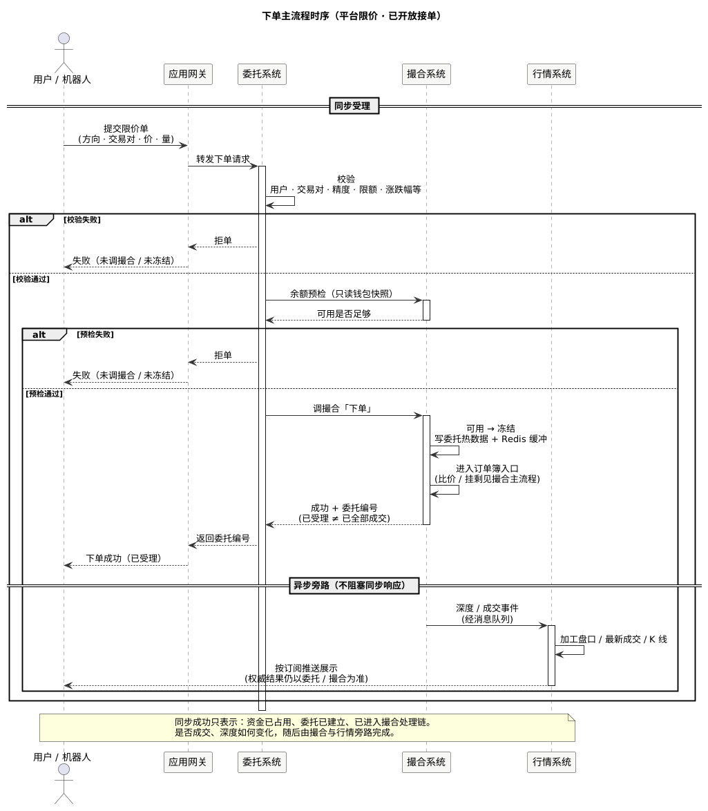

现货手册 · 核心交易流程 / TGEX KNOWLEDGE BASE

# 下单主流程

平台限价单沿时序：用户 / 机器人 → 应用网关 → 委托系统 → 撮合系统；同步返回委托编号（已受理 ≠ 已全部成交）。深度与成交由撮合异步交给行情系统推送展示。

  

本文假定服务已起来、交易对已可接单；以 **平台撮合 · 限价单** 为主路径。下文按上图时序展开。进簿之后的比价、挂剩见[撮合主流程](/pages/070508)；展示侧见[行情推送流程](/pages/070509)。

## 1. 用户 / 机器人 → 应用网关

调用方（App、开放 API、量化机器人等）提交限价单，经应用网关进入委托。

关键字段：买卖方向、交易对、价格、数量、来源；App 侧通常还要交易密码。

## 2. 应用网关 → 委托系统

网关只做转发与接入，不在本文展开鉴权细节。请求到达委托下单接口后，进入同步受理段。

## 3. 委托：校验

调撮合「下单」之前，委托侧先完成本地校验。任一步失败则走时序上的「拒单」支，**经网关回调用方，不调撮合、不冻结**：

1. 入参完整性（限价须有合法正价格与数量）  
2. 用户可交易状态（App 含交易密码；API / 机器人等按来源）  
3. 商户交易对：存在、启用、买卖开关、停盘时段  
4. 特殊业务限额（活动对等，按配置）  
5. 涨跌幅（平台撮合相对开盘价等）  
6. 精度截断与价量上下限  
7. 客户端订单号幂等（已存在则拒绝重复）

第三方（非平台）撮合交易对另分支，不在本文主路径。

## 4. 委托 → 撮合：余额预检

校验通过后，委托向撮合读取币币钱包快照：买单看「价 × 量」计价币是否够，卖单看基础币是否够。

**只预检，不改可用 / 冻结。** 预检失败同样拒单、不进入下一节「下单」。真正占用发生在调撮合「下单」成功之后。

## 5. 委托 → 撮合：下单

预检通过后，委托调用撮合下单。平台限价路径上，权威委托态与冻结收敛到撮合侧：一次调用覆盖冻结、建委托、触发进簿。

撮合侧在同步路径上完成：

1. **可用 → 冻结**，写委托热数据与 Redis 缓冲（买冻计价币 / 卖冻基础币）  
2. **进入订单簿入口**（比价、挂剩不在同步「已成交」语义里；细节见[撮合主流程](/pages/070508)）

钱包内如何减可用、加冻结见[用户币币账户缓存 · 增量：可用 → 冻结](/pages/070802#total-to-frozen)。

撮合回委托：**成功 + 委托编号**。含义是冻结与建单已成功、已进入处理链，**不等于已全部成交**。

## 6. 同步返回调用方

委托经网关把结果回给用户 / 机器人：

| 结果 | 含义 |
| --- | --- |
| 成功 + 委托编号 | 已受理：资金已占用，委托已建立，已进入撮合处理链 |
| 校验 / 预检失败 | 未调撮合「下单」、未冻结 |
| 撮合拒绝 / 冻结失败 | 通常无冻结 |
| 调撮合超时 | **可能已冻结**：先按业务编号 / 客户端订单号查询，禁止未知时再发一笔新冻结 |

状态与成交明细不在下单同步响应里带齐；资金教学表见[业务流程 · 下单与资金冻结](/pages/070501#place)。

## 7. 异步旁路：撮合 → 行情 → 展示

同步响应返回之后（或不阻塞同步等待），撮合将深度 / 成交等事件经消息队列交给行情系统。行情加工盘口、最新成交或 K 线，再按订阅推给客户端。

推送只服务展示，**不改**订单与资金的权威结果。断线后应先拉快照再接增量，见[行情推送流程](/pages/070509)。

## 本文边界

| 对照 | 说明 |
| --- | --- |
| [撮合主流程](/pages/070508) | 进簿后比价、成交、外发意向 |
| [撤单主流程](/pages/070503) | 撤销未完成委托 |
| [行情推送流程](/pages/070509) | 展示侧如何推深度与成交 |
| [委托 / 撮合初始化](/pages/070504) | 启动准备；本文假定已可接单 |
| [业务流程](/pages/070501) | 资金教学，不重复演算 |

同组：[撮合主流程](/pages/070508) · [撤单主流程](/pages/070503) · [行情推送流程](/pages/070509) · [业务流程](/pages/070501) · [委托初始化链路](/pages/070504) · [用户币币账户缓存](/pages/070802)
