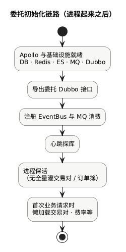

现货手册 · 核心交易流程 / TGEX KNOWLEDGE BASE

# 委托初始化链路

委托服务启动后不做「按交易对灌订单簿」：接口可对外、消息可消费，交易对与费率等在首次请求时再装。

  

工程：`coinex-entrust`。下文按上图节点展开。与撮合初始化对比：撮合要恢复盘口并开放接单；委托只保证门面与通道就绪。

## 1. Apollo 与基础设施就绪

数据源、MyBatis、Redis（Jedis / Redisson）、Elasticsearch、RocketMQ、Dubbo 注册与协议端口在 Spring 刷新阶段完成。  
Consumer 侧通常 `check=false`：**不因下游暂时不在线而拒绝启动**。

## 2. 导出委托 Dubbo 接口

本进程对外提供下单 / 撤单门面、统计、机器人刷单、与行情相关的委托查询等。  
客户端或撮合、账务补偿链路能发现这些接口，是 entrust「业务上线」的第一层含义。

## 3. 注册 EventBus 与 MQ 消费

`ContextRefreshedEvent` 后注册监听（如限购变更、批量撤单、账务超时相关），启动时只注册，不跑全站委托。

订阅主题（以代码启用为准）含预撮合处理、历史委托转 ES、账务超时补偿等。有积压则启动后立刻消费；没有「先读完所有历史委托再对外」。

## 4. 心跳探库

`HeartbeatService` 轻量查库（如查一条委托）确认库连通。  
探活通过只说明进程 + 数据库探针 OK，不保证撮合各交易对已开放接单。

## 5. 进程保活（无全量预热）

`ApplicationRunner` 业务体为空；Ready 后没有一次性全量 init。约 1 秒后 `MqService` 扫描失败 MQ 重试队列，属运维补偿，不是交易对预热。

## 6. 首次请求时懒加载

下列本地缓存为 LoadingCache / 按需 Redis，启动时不 bulk load：

| 缓存 | 典型触发 |
| --- | --- |
| 商户交易对 / 币种 / 商户信息 | 首次下单或查对 |
| 用户费率 / VIP | 首次算费 |
| 限购活动 | 首次触及 PRE 限购 |
| 委单 JSON | 读写单笔委托 |

因此第一次真实下单才会去拉交易对规则、用户状态等；启动日志里看不到撮合式「初始化交易对 success」是正常的。

## 就绪怎么理解

| 层级 | 含义 |
| --- | --- |
| 框架 / 接口 / 消息 / 探活 Ready | 进程保活、Dubbo 已注册、Consumer 已订阅、心跳查库成功 |
| 业务热路径 Ready | **不在启动完成时保证**；取决于首次请求时 account / match / coin 是否可用 |

## 本文边界

贯穿示例里提交买单 / 撤单首先打到委托：校验后调撮合。启动只保证「门面在」；真实路径见[下单主流程](/pages/070506)。盘口历史挂单见[撮合初始化链路](/pages/070503)。

同组：[撮合初始化链路](/pages/070503) · [账务初始化链路](/pages/070504) · [下单主流程](/pages/070506)
