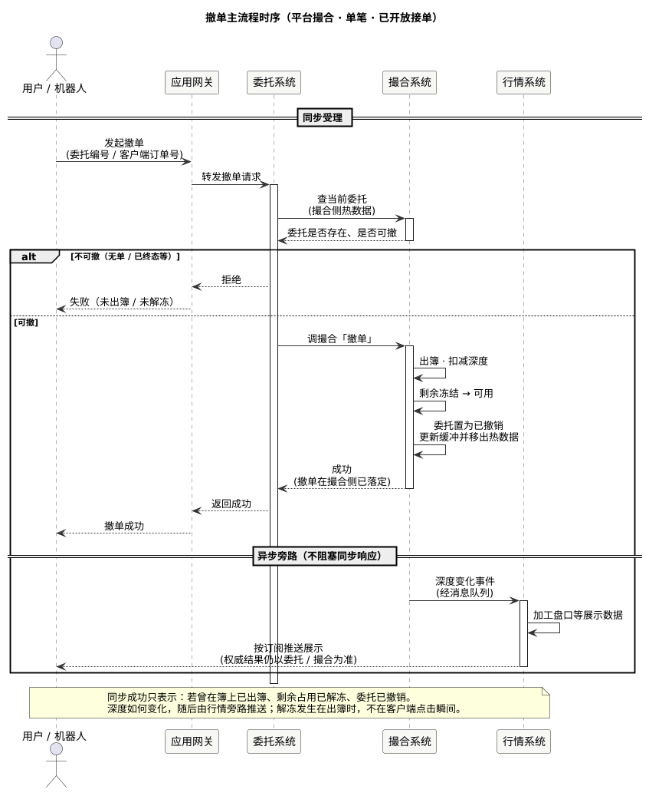

现货手册 · 核心交易流程 / TGEX KNOWLEDGE BASE

# 撤单主流程

单笔撤单沿时序：用户 / 机器人 → 应用网关 → 委托系统 → 撮合系统；查到仍可撤的单后出簿解冻并置为已撤销。同步成功表示撮合侧已落定；深度变化由行情系统异步推送。

  

本文假定服务已起来、交易对已可接单；以 **平台撮合 · 单笔撤单** 为主路径。下文按上图时序展开。引擎内出簿与解冻与[撮合主流程 · 撤单](/pages/070508)同一条处理链；展示侧见[行情推送流程](/pages/070509)。

## 1. 用户 / 机器人 → 应用网关

调用方（App、开放 API、量化机器人等）发起撤单，经应用网关进入委托。

常见入参：委托编号（或客户端订单号 + 用户）、必要时版本号等。批量撤单、一键撤是并行能力，本文不展开。

## 2. 应用网关 → 委托系统

网关只做转发与接入，不在本文展开鉴权细节。请求到达委托撤单接口后，进入同步受理段。

## 3. 委托 → 撮合：查当前委托

委托侧向撮合热数据查询这张单是否还在、属于谁、是否仍可撤。

| 查不到或不可撤 | 结果 |
| --- | --- |
| 无此委托 | 经网关拒绝（未出簿 / 未解冻） |
| 已完全成交 / 已撤销 | 拒绝（终态不能再撤） |
| 仍有未成交剩余且状态允许 | 继续调撮合「撤单」 |

第三方（非平台）撮合交易对另分支，不在本文主路径。

## 4. 委托 → 撮合：撤单

可撤时，委托调用撮合撤单。事件进入与下单相同的撮合处理链（同交易对串行），与可能同时到来的成交抢同一剩余量——以引擎内先后结果为准。

撮合侧在同步路径上完成（亦见[撮合主流程](/pages/070508)撤单支）：

1. 若单仍在订单簿：**出簿**，按剩余量扣深度，从价位队列拿掉  
2. 未成交占用 **冻结 → 可用**（买退计价币，卖退基础币）  
3. 委托置为已撤销，更新 Redis 缓冲，并从委托热数据移除  

解冻发生在出簿时，而不是「点撤单」的客户端瞬间。资金数字见[业务概述 · 案例](/pages/0701#complete)。

撮合回委托：**成功**。含义是撤单在撮合侧已落定。

## 5. 同步返回调用方

委托经网关把结果回给用户 / 机器人：

| 结果 | 含义 |
| --- | --- |
| 成功 | 撮合侧已出簿（若曾在簿上）、剩余已解冻、委托已撤销 |
| 拒绝 | 无单、已终态、或撮合侧判定不可撤 |
| 调撮合超时 | 结果未知：先按[委托查询主流程](/pages/070510)确认终态，勿重复盲目连点当作多笔新业务 |

深度变化不保证出现在撤单同步响应里。

## 6. 异步旁路：撮合 → 行情 → 展示

同步响应返回之后（或不阻塞同步等待），撮合将深度变化等事件经消息队列交给行情系统。行情加工盘口等展示数据，再按订阅推给客户端。

推送只服务展示，**不改**订单与资金的权威结果。断线后应先拉快照再接增量，见[行情推送流程](/pages/070509)。

## 本文边界

| 对照 | 说明 |
| --- | --- |
| [下单主流程](/pages/070502) | 对称：怎么把单送进撮合 |
| [撮合主流程](/pages/070508) | 引擎内撤单支与下单支同链 |
| [委托查询主流程](/pages/070510) | 撤前 / 超时后确认单是否仍可撤 |
| [行情推送流程](/pages/070509) | 展示侧如何推深度变化 |
| [业务概述 · 案例](/pages/0701#complete) | 资金教学；与成交抢量的语义 |
| 批量 / 第三方撤单 | 不展开 |

同组：[下单主流程](/pages/070502) · [撮合主流程](/pages/070508) · [委托查询主流程](/pages/070510) · [行情推送流程](/pages/070509) · [业务概述](/pages/0701)
