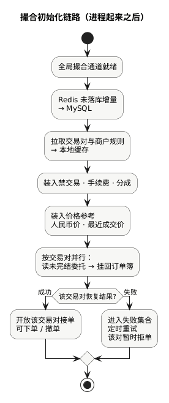

现货手册 · 核心交易流程 / TGEX KNOWLEDGE BASE

# 撮合初始化链路

进程起来后：先备好通道与规则，再按交易对把未完结委托挂回盘口，最后才对该对开放下单与撤单。

  

| 状态 | 含义 |
| --- | --- |
| 进程已起来 | 全局撮合通道可用，**不等于**每个交易对都能下单 |
| 某交易对已开放 | 该对未完结委托已挂回订单簿，可接受新的下单 / 撤单 |

下文按上图节点展开。开放接单之后的实时下单 / 撤单见[撮合主流程](/pages/070507)。

## 1. 全局撮合通道就绪

准备全局事件通道与订单簿基础设施（依赖 Redis）。  
整站可处理内部事件；若后续「未落库刷库」多次失败，可能关掉全局通道，表现为暂时整站拒写。

## 2. Redis 未落库增量 → MySQL

启动时**同步**消化：上次异常停机留在 Redis 队列、尚未写入 MySQL 的增量（账户、委托、明细一类）。

目的：先把「上次没落完的账」尽量落完，再恢复盘口。刷完后另起后台任务持续消费 Redis → 库，与按交易对恢复并行。

## 3. 拉取交易对与商户规则

| 数据 | 用途 |
| --- | --- |
| 平台交易对 | 有哪些 symbol、买卖币 |
| 商户启用交易对 | 哪些商户开了哪些对 |

**没有可用交易对，后面无法按对恢复，也无法开放接单。**

## 4. 装入禁交易 · 手续费 · 分成

在启用商户列表上继续装入：禁止交易用户、平台币抵扣、商户分成、VIP 费率等。启动时先拉齐，避免「第一笔成交才去拼费率」。

## 5. 装入价格参考

币种人民币价、各交易对最近成交价等，供撮合侧价格参考与折算。

## 6. 按交易对并行：挂回订单簿

对每个交易对（并行）大致：创建该对引擎 → 暂时关闭接单 → 读未完结委托 → 挂回订单簿。

| 路径 | 数据来源 | 适用 |
| --- | --- | --- |
| 热恢复 | Redis 中该对未完结委托 | 常见重启 |
| 冷恢复 | MySQL 未成交 / 部分成交 | 首次或标记要求走库 |

热恢复时还会按需补齐相关用户币币资产到本地缓存，并刷新深度。另有非交易对通道（充提、改账等）不挂普通买卖盘。

## 7. 开放接单或失败重试

| 结果 | 行为 |
| --- | --- |
| 成功 | **开放该交易对接单**，可下单 / 撤单 |
| 失败 | 进入失败集合，定时重试；成功前该对应拒单 |

主流程只保证「各对恢复任务已提交」，**不保证**全部交易对同一时刻都已开放。常见情况：有的对已开放，有的对仍在重试。

若环境启用高频策略，还会从 Redis 恢复当日卖单计数等附属数据。运行期仍会定时刷新交易对、分成、汇率等。

## 就绪怎么理解

| 层级 | 能做什么 |
| --- | --- |
| 全局通道 | 内部事件通道可用 |
| 规则就绪 | 具备按规则处理的前提 |
| 单交易对开放 | 可接受该对下单 / 撤单 |
| 部分未完成 | 这些对暂时不可交易 |

## 本文边界

| 依赖 | 用途 |
| --- | --- |
| Redis / MySQL | 未落库队列、热委托、冷恢复、刷库目标 |
| 交易对 / 商户 / 用户 / 账务 / 行情 | 清单、禁交易、费率、钱包快照、最近价 |

建议：账务、交易对、行情至少部分可用后，再观察「按交易对是否已开放」。业务语义见[业务流程 · 撮合与成交](/pages/070501#match)。

同组：[委托初始化链路](/pages/070502) · [账务初始化链路](/pages/070504) · [行情初始化链路](/pages/070505) · [撮合主流程](/pages/070507)
