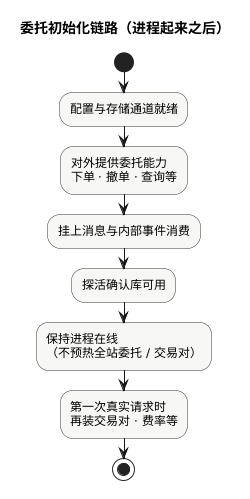

现货手册 · 核心交易流程 / TGEX KNOWLEDGE BASE

# 委托初始化链路

委托服务起来之后，目标很简单：能接住下单 / 撤单 / 查询，能处理相关消息；不会像撮合那样把全站交易对和盘口先灌满。

  

下文按上图节点展开。和[撮合初始化链路](/pages/070505)的差别：撮合要恢复盘口并开放接单；委托只保证「门面在、通道通」，规则与配置多半在第一次真实请求时再取。

## 1. 配置与存储通道就绪

配置、数据库、缓存、检索、消息、远程调用等通道先打通。  
下游暂时不在线，一般**不挡**本服务起来——真正下单时再依赖对方是否可用。

## 2. 对外提供委托能力

此时别人已经能调用：下单、撤单、委托查询、统计、机器人相关能力等。  
对业务读者来说，这是「委托服务已上线」的第一层含义：门面在，请求有地方进。

## 3. 挂上消息与内部事件消费

开始监听与委托相关的消息和内部事件，例如：限购变更、批量撤单、账务超时补偿、历史委托归档一类。

启动时只是**挂上监听**，不会把全站历史委托扫一遍。若队列里已有积压，起来后会立刻消化；这和「预热盘口」不是一回事。

## 4. 探活确认库可用

定期用很轻的查库确认数据库还通。  
探活通过只说明「进程在、库能问」；**不**表示撮合侧每个交易对已经开放接单。

## 5. 保持进程在线（不预热全站）

服务保持运行即可。启动阶段**没有**「把所有交易对、所有费率、所有委托灌进内存」这一步。  
另有失败消息重试一类运维补偿，属于旁路，不是交易对预热。

## 6. 第一次真实请求时再装规则

交易对规则、币种、商户信息、用户费率 / VIP、限购活动等，多在**第一次用到时**再装进本地缓存。

因此：第一次真实下单，才会去拉交易对能不能买、精度多少、费率多少。  
启动日志里看不到撮合那种「交易对初始化成功」是正常的——委托本来就不在启动时做这件事。

## 就绪怎么理解

| 问法 | 答案 |
| --- | --- |
| 能不能调委托接口？ | 第二节完成后可以 |
| 消息会不会丢在门口？ | 第三节挂上后可以消费 |
| 库通不通？ | 看探活 |
| 是不是已经能完整下单？ | **还要看**撮合是否开放该交易对、账务 / 币种等下游是否可用——不在委托启动完成时打包保证 |

## 本文边界

用户提交买单 / 撤单首先进委托：校验后再进撮合。启动只保证门面与通道；真实下单见[下单主流程](/pages/070502)，撤单见[撤单主流程](/pages/070503)。盘口里的历史挂单来自[撮合初始化链路](/pages/070505)。

同组：[撮合初始化链路](/pages/070505) · [账务初始化链路](/pages/070506) · [下单主流程](/pages/070502) · [撤单主流程](/pages/070503)
