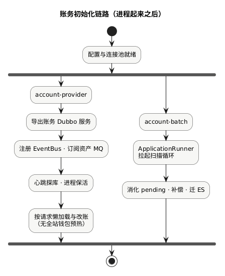

现货手册 · 核心交易流程 / TGEX KNOWLEDGE BASE

# 账务初始化链路

在线账务不做全站钱包预热，就绪即接口与消息可用；批处理进程启动后立刻扫 pending。图上两支并行，对应两个可运行进程。

  

工程：`coinex-account`。

| 进程 | 角色 |
| --- | --- |
| `account-provider` | 在线 Dubbo + MQ 改账 |
| `account-batch` | 消化 pending、迁 ES |

下文按上图节点展开。平台现货 V1 热路径冻结多在撮合内存；本链路仍说明账务工程自身如何就绪。

## 1. 配置与连接池就绪

Apollo 注入数据源、Dubbo、Redis、ES 等；MyBatis、Jedis / Redisson、ES 客户端在刷新阶段建立。  
Dubbo Consumer `check=false` 时，下游暂时不在线也不阻断本进程启动。

## 2. account-provider：导出账务 Dubbo

扫描并导出用户币币钱包、商户钱包、业务账户操作、管理向调账等服务。注册中心可见后，其它工程才能调账务能力。

## 3. account-provider：EventBus · 资产 MQ

注册如账务异常写表、资产迁移类监听；启动时只注册，不扫全站账户。

订阅余额批量更新、提现/手续费结果、OTC 入账、外部划转等主题（以代码启用为准）。有积压则启动后立即消费；**改账发生在消费时，不在启动预热阶段**。

## 4. account-provider：心跳 · 保活

轻量查库确认 DB 可读；进程保活。另有运行期定时任务（充值对齐、C2C 超时等），不是一次性 init。

大量 `init*` 出现在开户 / 首次动某币钱包等**请求路径**上，不要写成「启动时全量 init 钱包」。

## 5. account-provider：按请求懒加载与改账

无全站钱包预热。provider 就绪 = 能响应相关 RPC 并能消费 MQ；全量资产视图**不存在**于启动完成时。

## 6. account-batch：拉起扫描循环

另一条进程。`ApplicationRunner` 就绪后启动多组调度（延迟约百毫秒～1 秒），典型包括：批量执行 pending、异常补偿、流水/快照迁 ES。失败时可能降级为更细粒度单用户执行。

## 7. account-batch：消化 pending · 迁 ES

Runner 已提交且循环已开始扫库。不预加载全站余额，但持续消化 provider 写下的 pending。现货高峰若只起 provider 不起 batch，会出现在线已变、检索 / 部分异步链路滞后。

## 就绪怎么理解

| 层级 | 含义 |
| --- | --- |
| provider：框架 / 接口 / 消息 / 探活 | 进程保活、Dubbo 已注册、Consumer 已订阅、心跳 OK |
| batch：循环已跑 | pending 开始被消化 |
| 全量资产预热 | **没有** |

## 本文边界

委托入口见[委托初始化链路](/pages/070502)；撮合见[撮合初始化链路](/pages/070503)；撮合侧钱包权威见[用户币币账户缓存](/pages/070802)；资金语义见[业务流程](/pages/070501)。

同组：[委托初始化链路](/pages/070502) · [撮合初始化链路](/pages/070503) · [行情初始化链路](/pages/070505)
