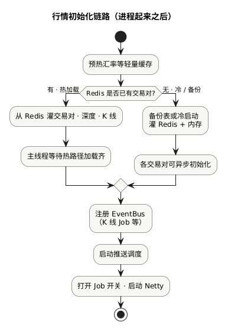

现货手册 · 核心交易流程 / TGEX KNOWLEDGE BASE

# 行情初始化链路

先判断交易对数据从哪里恢复并灌进内存，再注册事件与推送，最后打开 Job 开关与 Netty。

  

工程：`coinex-market` / `market-provider`。主加载在 `MarketManager` 的 `@PostConstruct`；Netty 与部分定时在 `ApplicationRunner`。下文按上图节点展开。

| 提醒 | 含义 |
| --- | --- |
| Spring Ready | 框架级就绪 |
| 热路径加载完成 | 内存中已有交易对、深度、K 线等，RPC 读行情基本可用 |
| Netty 已监听 | WebSocket 可连；冷启动时部分对仍可能在后台初始化 |
| Job 开关打开 | 外部 Job 触发的 K 线 / 核对才会真正执行 |

**Spring Ready ≠ Netty 已监听 ≠ 每个交易对深度都已齐。**

## 1. 预热汇率等轻量缓存

从 Redis 等灌入第三方汇率到内存。与交易对 K 线无关，属于轻量准备。

## 2. 判断 Redis 是否已有交易对

尝试从 Redis 全量加载交易对行情：有数据走热加载；否则走冷启动 / 备份恢复。

## 3a. 热加载（Redis 已有）

1. 取启用交易对；若一个都没有则结束加载。  
2. 从 Redis 解析交易对进内存；初始化 ticker、盘口相关结构。  
3. 按交易对加载深度、各周期 K 线等，并标记可推。  
4. **主线程等待**各对加载完成（热路径在 PostConstruct 内基本阻塞到齐）。

## 3b. 冷 / 备份恢复（Redis 没有）

有 MySQL 备份则灌回 Redis + 内存；无备份则冷启动（拉全量交易对、初始化第三方对接、各对异步灌深度 / K 线 / 成交历史）。

冷启动时 PostConstruct **可能很快返回**，各对仍在后台初始化——会出现「端口已开、部分深度仍空」的窗口。

## 4. 注册 EventBus

把 K 线 Job、落库监听等注册到 EventBus。Job 开关可能仍为关，真正执行要等到后面打开开关。

## 5. 启动推送调度

定时按订阅推 depth / ticker / trade / kline 及首页榜单等。此时 Netty 可能尚未 bind，无连接时任务空转属正常。

## 6. 打开 Job 开关 · 启动 Netty

同一调用链内大致：打开本机 Job 开关 → 第三方行情定时同步 → 异步启动 Netty → 拉币种/商户币种元数据 → 其它定时（折合人民币、人气榜等）。

## 就绪怎么理解

| 层级 | 能做什么 |
| --- | --- |
| 框架 Ready | Dubbo / Jetty / MQ Consumer 起来 |
| 热路径行情就绪 | RPC 读内存行情基本可用 |
| WS 可连 | 客户端可订阅 |
| Job 可驱动 | 分布式任务会在本机执行 |
| 冷启动未齐 | 部分交易对深度 / K 线暂时为空 |

运维心跳通常只检查 Redis 交易对列表是否可读，**不检查 Netty**。

## 本文边界

启动期常依赖：交易对服务、商户交易对、entrust 盘口（冷启动）、币种服务、第三方行情等。撮合侧见[撮合初始化链路](/pages/070503)；盘口业务语义见[行情与推送](/pages/0706)。

同组：[撮合初始化链路](/pages/070503) · [委托初始化链路](/pages/070502) · [账务初始化链路](/pages/070504)
