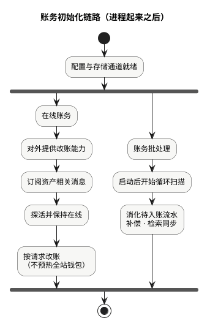

现货手册 · 核心交易流程 / TGEX KNOWLEDGE BASE

# 下单主流程

平台限价单：入口进委托 → 校验与余额预检 → 调撮合冻结建单 → 进入订单簿入口 → 同步返回委托编号（已受理，不等于已全部成交）。

  

本文假定服务已起来、交易对已可接单；以 **平台撮合 · 限价单** 为主路径。进簿之后的比价、成交见[撮合主流程](/pages/070507)。下文按上图节点展开。

## 1. 入口受理

App HTTP 或内部调用方（量化、开放 API、机器人等）提交限价单，进入委托下单接口。

限价单关键字段：买卖方向、交易对、价格、数量、来源；App 侧通常还要交易密码。

## 2. 委托侧校验

调撮合之前，委托侧依次检查（任一步失败则走图上「拒单」支，**不调撮合、不冻结**）：

1. 入参完整性（限价须有合法正价格与数量）  
2. 用户可交易状态（App 含交易密码；API / 机器人等按来源）  
3. 商户交易对：存在、启用、买卖开关、停盘时段  
4. 特殊业务限额（活动对等，按配置）  
5. 涨跌幅（平台撮合相对开盘价等）  
6. 精度截断与价量上下限  
7. 客户端订单号幂等（已存在则拒绝重复）

第三方（非平台）撮合交易对另分支，不在本文主路径。

## 3. 余额预检（不冻结）

读撮合侧币币钱包快照：买单看「价 × 量」计价币是否够，卖单看基础币是否够。

**只预检，不改可用/冻结。** 真正占用发生在下一节调撮合之后。预检失败同样拒单、不调撮合。

## 4. 调撮合「下单」

校验与预检通过后，委托侧组装报文，调用撮合下单接口。

平台限价路径上，权威委托态与冻结收敛到撮合侧（不再先在委托库插单、也不再先走独立账务冻结）。一次调撮合覆盖：冻结、建委托、触发进簿（进簿后的比价不在同步语义里等同「已成交」）。

## 5. 撮合：可用 → 冻结 · 写热数据

对应图上「撮合：可用 → 冻结 / 写委托热数据 + Redis 缓冲」，也是[撮合主流程](/pages/070507#bookkeeping)的冻结建单段。

撮合侧大致完成：进程与交易对可写校验、分配委托编号、买单冻计价币 / 卖单冻基础币、写委托热数据与 Redis 缓冲。  
钱包内如何减可用、加冻结见[用户币币账户缓存 · 增量：可用 → 冻结](/pages/070802#total-to-frozen)。

同步等待成功 = **冻结与建单已成功**，不等于已全部成交。

## 6. 进入订单簿入口

冻结建单成功后进入订单簿处理链；比价、挂剩、完全成交见[撮合主流程](/pages/070507)。本文写到入口为止。

## 7. 同步返回或拒单

| 结果 | 含义 |
| --- | --- |
| 成功 + 委托编号 | 已受理：资金已占用，委托已建立，已进入撮合处理链 |
| 校验 / 预检失败 | 未调撮合、未冻结 |
| 撮合拒绝 / 冻结失败 | 通常无冻结 |
| 调撮合超时 | **可能已冻结**：先按业务编号 / 客户端订单号查询，禁止未知时再发一笔新冻结 |

状态与成交明细靠后续查询与推送，不在下单同步响应里带「是否已成交」。资金教学表见[业务流程 · 下单与资金冻结](/pages/070501#place)。

## 本文边界

| 对照 | 说明 |
| --- | --- |
| [撮合主流程](/pages/070507) | 进簿后比价、成交、外发 |
| [撤单主流程](/pages/070508) | 撤销未完成委托 |
| [委托 / 撮合初始化](/pages/070502) | 启动准备；本文假定已可接单 |
| [业务流程](/pages/070501) | 资金教学，不重复演算 |

同组：[撮合主流程](/pages/070507) · [撤单主流程](/pages/070508) · [业务流程](/pages/070501) · [委托初始化链路](/pages/070502) · [用户币币账户缓存](/pages/070802)
