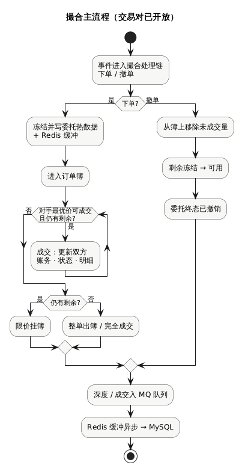

现货手册 · 核心交易流程 / TGEX KNOWLEDGE BASE

# 撮合主流程

交易对已开放后，事件入链：下单先冻结建单，再进簿成交或挂剩；撤单则出簿解冻。深度与成交异步外发，Redis 增量异步落库。

  

本文假定该交易对已完成初始化并开放接单；从「事件已进入撮合处理链」写起。委托侧校验与调撮合入口见[下单主流程](/pages/070506)；装交易对与恢复盘口见[撮合初始化链路](/pages/070503)。下文按上图节点展开。

## 1. 事件进入撮合处理链

同交易对事件串行投入全局通道。运行时主要两类：

| 类型 | 图上走哪一支 |
| --- | --- |
| 下单 | 左支：冻结建单 → 进簿 → 成交循环 → 挂剩或完全成交 |
| 撤单 | 右支：出簿 → 解冻 → 委托已撤销 |

两支在图末汇合，再走 MQ 与异步落库。上游（委托 RPC 等）同步等待的成功，通常表示**下单支的冻结建单已成功**，**不**表示已经全部成交；进簿与成交仍在同链继续。

## 2. 下单：冻结并写委托热数据 {#bookkeeping}

这一步对应图上的「冻结并写委托热数据 + Redis 缓冲」。

先记住结论：**钱先被系统占用，委托先记下来；但这时还没有挂到盘口，也还没有和任何人成交。**  
所以接口若在这一步就返回成功，多半只表示「下单已被受理、资金已占用」，不表示已经全部成交。

同一交易对里，处理顺序固定是两步：先完成本节，再进入下一节「进订单簿」。本节失败，就不会进盘口，也不会告诉上游成功。

### 按顺序做什么

**1.算该冻哪个币、冻多少**

| 方向 | 冻什么 | 怎么算（教学） |
| --- | --- | --- |
| 买 | 计价币（如 USDT） | 按这单要付的计价金额占用 |
| 卖 | 基础币（如 BTC） | 按这单要卖的数量占用 |

例：买入 0.01 BTC、价 60,000 → 大约冻 600 USDT。钱仍在该用户自己账户里，只是从「可用」变成「冻结」，**不会在这一步划给卖方**。手续费一般在后面成交时再扣。

**2.在撮合内存里：可用 → 冻结**

改的是撮合进程里的[用户币币账户缓存](/pages/070802)（按用户 × 币种存的那条内存钱包）。运行中以这份为准：够不够、能不能挂单，都先看这里。该钱包上如何校验、减可用、加冻结、记流水，见缓存文档[增量：可用 → 冻结](/pages/070802#total-to-frozen)；此处只记结论：

- 同一用户、同一币种内部占用，不是转给别人。  
- 成功才继续写 Redis / 热委托；失败 → **整笔失败**，不进盘口。

**3.往 Redis 记一份「本笔发生了什么」**

不是把整张账户缓存搬到 Redis，也不是改完余额就改以 Redis 为准。  只是把**这一笔动过的内容**旁路记出去，例如：  
- 账户变动结果（含变动后的钱包快照）  
- 委托当前内容（以及事件相关记录）

用途主要是：进程挂了还能恢复、后台再慢慢刷进 MySQL。下单热路径判断余额时，仍然看撮合内存，不拿这份 Redis 当裁判。

**4.写入委托热数据**

把这张单写进[委托热数据缓存](/pages/070803)（按委托号等索引）。  
此时状态一般是「未成交」，剩余量 = 下单量。  
注意：热数据里「有这张单」≠ 盘口上「已经挂出去」——挂盘口是下一节的事。

**5.本节怎样算结束**

| 结果 | 接下来 |
| --- | --- |
| 成功 | 可以进入「进订单簿」；等待中的上游可收到受理成功 |
| 失败 | 停在这里：不进盘口、资金没有成功占用 |

### 两个容易混的点

- **恢复历史挂单**（撮合重启把未完结单摆回盘口）走初始化链路，不会在本节再扣一遍可用。见[撮合初始化链路](/pages/070503)。  
- 用户感觉「一下单就成交了」：工程上仍是先做完本节占用与建单，再进下一节比价；只是两步挨得很紧。

## 3. 下单：进入订单簿 · 成交或挂剩

本节带着已建好的委托进该交易对订单簿：能撮就连续成交，否则把剩余挂在盘口（或已完全成交则新单不留簿）。

买档价高优先，卖档价低优先；同价先进先出。

### 比价怎么走

**买单（限价）**

1. 剩余量 = 本单数量。  
2. 反复取**卖盘最优价**：若最优卖价 ≤ 本单限价且仍有剩余，则在该价与卖方队列成交。  
3. 一档吃完再试下一档，直到价不满足或量用尽。  
4. 若仍有剩余 → **限价挂入买盘**；若无剩余 → **整单出簿 / 完全成交**（新单不留盘口）。

**卖单（限价）**对称：吃买盘，条件为最优买价 ≥ 本单限价；剩余挂入卖盘。

### 一笔成交时大致做什么

| 动作 | 说明 |
| --- | --- |
| 成交量 | 双方剩余量的较小值 |
| 成交价 | 按买卖限价与参考价规则确定 |
| 委托状态 | 有剩余 → 部分成交；剩余为 0 → 完全成交（可移出热委托） |
| 账务 | 解冻占用、划转资产、计手续费（撮合内存账本） |
| 落缓冲 | 账户、委托、成交明细写入 Redis |
| 外发意向 | 深度、最新成交、成交通知进入发送队列（图末统一外发） |

| 结果 | 订单簿 | 委托 |
| --- | --- | --- |
| 价不满足 / 无对手 | 整单挂簿 | 未成交 |
| 部分成交 | 剩余挂簿 | 部分成交 |
| 全部成交 | 新单不留簿 | 完全成交 |

教学数字见[业务流程 · 撮合与成交](/pages/070501#match)、[成交结算](/pages/070501#settle)。

用户可能感觉「一下单就成交」：工程上仍是**先完成上一节冻结建单，再进入本节进簿**；同步返回往往在上一节成功时已发出。

## 4. 撤单：出簿解冻

撤单走图上右支，与下单共用处理链，**不解冻在进链瞬间做，而在出簿时做**。

### 关键动作

1. 若委托仍在簿上：按剩余量扣深度，从价位队列移除。  
2. 未成交占用 **冻结 → 可用**（买退计价币，卖退基础币）。  
3. 委托置为已撤销，更新 Redis 缓冲并移出热委托。

已完全成交或不在簿上的单，撤单可能无效或拒绝。撤单与成交争同一剩余量时，以引擎内串行结果为准——不能按客户端点击瞬间的旧快照解冻。见[业务流程 · 撤单](/pages/070501#cancel)。

## 5. 深度 / 成交外发与异步落库

下单支与撤单支汇合后，实时改账仍以撮合内存为准；推送与落库走旁路：

| 通道 | 作用 |
| --- | --- |
| 深度 / 成交 MQ | 挂单、成交扣档、撤单引起的档位与最新成交；另有业务成交通知 |
| Redis → MySQL | 账户、委托、成交等增量由后台刷库；终态委托还可进检索 |

刷库积压或写 Redis 严重失败时，可能影响整站可写能力——属运行保障，不是单笔下单校验范畴。

## 本文边界

| 对照 | 说明 |
| --- | --- |
| [撮合初始化链路](/pages/070503) | 恢复历史未完结委托**摆回**订单簿并开放接单；不是本文的新单比价 |
| [下单主流程](/pages/070506) | 入口校验与调撮合；本文从入链起 |
| [业务流程](/pages/070501) | 资金教学表；本文不重复演算 |
| 热路径依赖 | 内存订单簿 + 账户 / 委托缓存；Redis 缓冲；MQ；MySQL 为异步目标 |

同组：[下单主流程](/pages/070506) · [撮合初始化链路](/pages/070503) · [业务流程](/pages/070501) · [用户币币账户缓存](/pages/070802)
