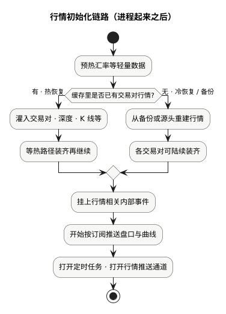

现货手册 · 核心交易流程 / TGEX KNOWLEDGE BASE

# 行情初始化链路

行情起来之后：先判断盘口与曲线从哪恢复并装进内存，再挂上事件与推送，最后打开定时任务和对外推送通道。

  

下文按上图节点展开。请先分清几层「看起来像好了」：

| 状态 | 实际表示 |
| --- | --- |
| 进程已起来 | 框架级就绪，不等于盘口都齐 |
| 热路径行情已装齐 | 内存里已有交易对、深度、K 线等，读行情基本可用 |
| 推送通道已打开 | 客户端可以连上收推送；冷恢复时部分交易对仍可能在后台装 |
| 定时任务已打开 | 生成 K 线、核对交易对一类任务才会真正跑 |

**进程起来 ≠ 推送已开 ≠ 每个交易对深度都齐。**

## 1. 预热汇率等轻量数据

先装与交易对 K 线无关的轻量数据（如第三方汇率），为后面折算与展示做准备。

## 2. 判断缓存里是否已有交易对行情

看本地热缓存里是否已有交易对行情快照：有则走热恢复；没有则走冷恢复或备份重建。

## 3a. 热恢复（缓存已有）

1. 确认有启用中的交易对；一个都没有则后面无从装行情。  
2. 把交易对、最新价、盘口结构等装进内存。  
3. 按交易对装深度、各周期 K 线等，并标记「可以推」。  
4. 等这批热路径装齐，再往下开推送相关步骤。

## 3b. 冷恢复 / 备份（缓存没有）

有备份则把备份灌回缓存与内存；没有备份则从源头重建交易对列表，再按交易对陆续装深度、K 线、成交历史。

冷恢复时，服务可能**很快就能对外**，但各交易对仍在后台陆续装齐——会出现「已经能连，部分交易对深度暂时为空」的窗口。

## 4. 挂上行情相关内部事件

挂上生成 K 线、落库一类内部事件。此时定时任务开关可能仍关着，真正执行要等到后面打开。

## 5. 开始按订阅推送

按客户端订阅推送深度、最新价、成交、K 线，以及首页榜单一类低频内容。  
推送通道若尚未打开，任务可能空转一会儿，属正常现象。

## 6. 打开定时任务 · 打开行情推送通道

打开本机行情定时任务；必要时同步外部行情源；打开面向客户端的推送通道；再补币种名称、折算、人气榜一类展示数据。

## 就绪怎么理解

| 问法 | 答案 |
| --- | --- |
| 进程起来了吗？ | 框架就绪即可回答 |
| 读内存行情靠谱吗？ | 看热路径是否装齐（热恢复通常更齐） |
| 客户端能连上推送吗？ | 看推送通道是否已开 |
| 每个交易对深度都有了吗？ | 冷恢复时可能还没有，要按交易对看 |

运维探活常常只确认「交易对列表能不能读到」，**不**等于推送通道已开。

## 本文边界

盘口与曲线如何推到客户端，见[行情推送流程](/pages/070509)。撮合侧恢复盘口见[撮合初始化链路](/pages/070505)。

同组：[撮合初始化链路](/pages/070505) · [委托初始化链路](/pages/070504) · [账务初始化链路](/pages/070506) · [行情推送流程](/pages/070509)
