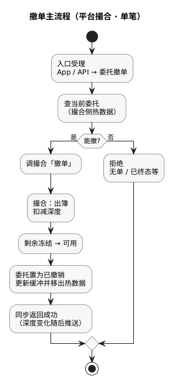

现货手册 · 核心交易流程 / TGEX KNOWLEDGE BASE

# 撤单主流程

用户撤销未完成委托：入口进委托 → 查到仍可撤的单 → 调撮合出簿 → 剩余占用退回可用 → 委托变为已撤销。同步成功表示撤单在撮合侧已落定；深度变化随后走推送旁路。

  

本文假定服务已起来、交易对已可接单；以 **平台撮合 · 单笔撤单** 为主路径。撮合引擎内出簿与解冻细节与[撮合主流程 · 撤单](/pages/070507)同一条处理链，本文补齐**委托入口到调撮合**这一段。下文按上图节点展开。

## 1. 入口受理

App HTTP 或 API / 量化等调用方发起撤单，进入委托撤单接口。  
常见入参：委托编号（或客户端订单号 + 用户）、必要时版本号等。批量撤单、一键撤是并行能力，本文不展开。

## 2. 查当前委托

委托侧向撮合热数据查询这张单是否还在、属于谁。

| 查不到或不可撤 | 结果 |
| --- | --- |
| 无此委托 | 拒绝 |
| 已完全成交 / 已撤销 | 拒绝（终态不能再撤） |
| 仍有未成交剩余且状态允许 | 继续 |

第三方（非平台）撮合交易对走另一分支，不在本文主路径。

## 3. 调撮合「撤单」

平台单由委托侧调用撮合撤单。事件进入与下单相同的撮合处理链（同交易对串行），与可能同时到来的成交抢同一剩余量——以引擎内先后结果为准。

## 4. 撮合：出簿 · 解冻 · 终态

对应图上出簿到已撤销，也是[撮合主流程](/pages/070507)撤单支：

1. 若单仍在订单簿：按剩余量扣深度，从价位队列拿掉。  
2. 未成交占用 **冻结 → 可用**（买退计价币，卖退基础币）。  
3. 委托置为已撤销，更新 Redis 缓冲，并从委托热数据移除。

解冻发生在出簿时，而不是「点撤单」的客户端瞬间。资金数字见[业务流程 · 撤单](/pages/070501#cancel)。

## 5. 同步返回或拒绝

| 结果 | 含义 |
| --- | --- |
| 成功 | 撮合侧已出簿（若曾在簿上）、剩余已解冻、委托已撤销 |
| 拒绝 | 无单、已终态、或撮合侧判定不可撤 |
| 超时 | 结果未知：先按委托编号查询终态，勿重复盲目连点当作多笔新业务 |

深度变化、成交通知不保证出现在撤单同步响应里；展示侧见[行情推送流程](/pages/070509)。

## 本文边界

| 对照 | 说明 |
| --- | --- |
| [下单主流程](/pages/070506) | 对称：怎么把单送进撮合 |
| [撮合主流程](/pages/070507) | 引擎内撤单支与下单支同链 |
| [业务流程 · 撤单](/pages/070501#cancel) | 资金教学；与成交抢量的语义 |
| 批量 / 第三方撤单 | 不展开 |

同组：[下单主流程](/pages/070506) · [撮合主流程](/pages/070507) · [业务流程](/pages/070501) · [行情推送流程](/pages/070509)
