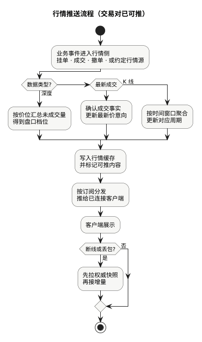

现货手册 · 核心交易流程 / TGEX KNOWLEDGE BASE

# 行情推送流程

交易过程中的挂单、成交、撤单（或约定行情源）进入行情侧后：加工成深度、最新成交或 K 线，写入缓存并按订阅推给客户端。推送只服务展示，不改订单与资金的权威结果。

  

本文假定行情侧已能推（见[行情初始化链路](/pages/070507)）。撮合侧如何产出深度 / 成交外发意向，见[撮合主流程](/pages/070508)文末旁路。下文按上图节点展开。

## 1. 业务事件进入行情侧

常见来源：

| 来源 | 典型带来什么 |
| --- | --- |
| 挂单 / 撤单 / 成交扣档 | 深度变化 |
| 已确认成交 | 最新成交、最新价、K 线素材 |
| 约定外部行情源 | 展示或策略用的 tick（须标明与本地成交的关系） |

外部 tick 可以驱动展示或策略，**不能**被说成「本地用户之间已经发生的成交」。外部接入另见[机器人与量化](/pages/1201#external)。

## 2. 按类型加工

| 类型 | 做什么 | 不要误解成 |
| --- | --- | --- |
| 深度 | 未成交订单按价位汇总成盘口档位 | 用户全部历史委托 |
| 最新成交 | 只反映已确认成交事实 | 合约标记价 / 指数价 |
| K 线 | 按时间窗口聚合行情事件 | 单笔订单状态 |

现货没有合约那套标记价与资金费口径。页面「最新价」通常来自最近确认成交或约定行情源，**不能**替代订单与账务核对。

设计上应能回答：深度是否只来自本地订单簿？最新成交是否只发已确认成交？K 线窗口与时区如何约定？

## 3. 写入行情缓存并标记可推

加工结果写入行情侧缓存，并标记本轮哪些内容需要推（深度、ticker、成交、某周期 K 线等）。  
缓存服务于展示与订阅分发，不是撮合内存账本。

## 4. 按订阅分发 · 客户端展示

按客户端已订阅的内容推送；未连接时任务可能空转。  
主题名与接口路径以接口文档为准，本文不虚构地址。

## 5. 断线或丢包时：先快照再增量

客户端应先重新获取权威快照，再按协议接增量。只回放增量、不重建快照，容易在丢包后出现「盘口数量对不上」。

行情短暂不更新，不一定代表不能交易；行情正常也不证明订单和资金健康——排查交易故障时，行情只能排除展示层的一部分问题。

## 本文边界

| 对照 | 说明 |
| --- | --- |
| [行情初始化链路](/pages/070507) | 服务起来后如何装交易对、开推送通道 |
| [撮合主流程](/pages/070508) | 引擎内成交与外发意向；本文接展示侧 |
| [核心设计 · 订单簿](/pages/0704#orderbook) | 盘口业务对象；本文讲如何推出去 |

同组：[行情初始化链路](/pages/070507) · [撮合主流程](/pages/070508) · [撤单主流程](/pages/070503) · [业务概述](/pages/0701) · [系统架构](/pages/0702)
